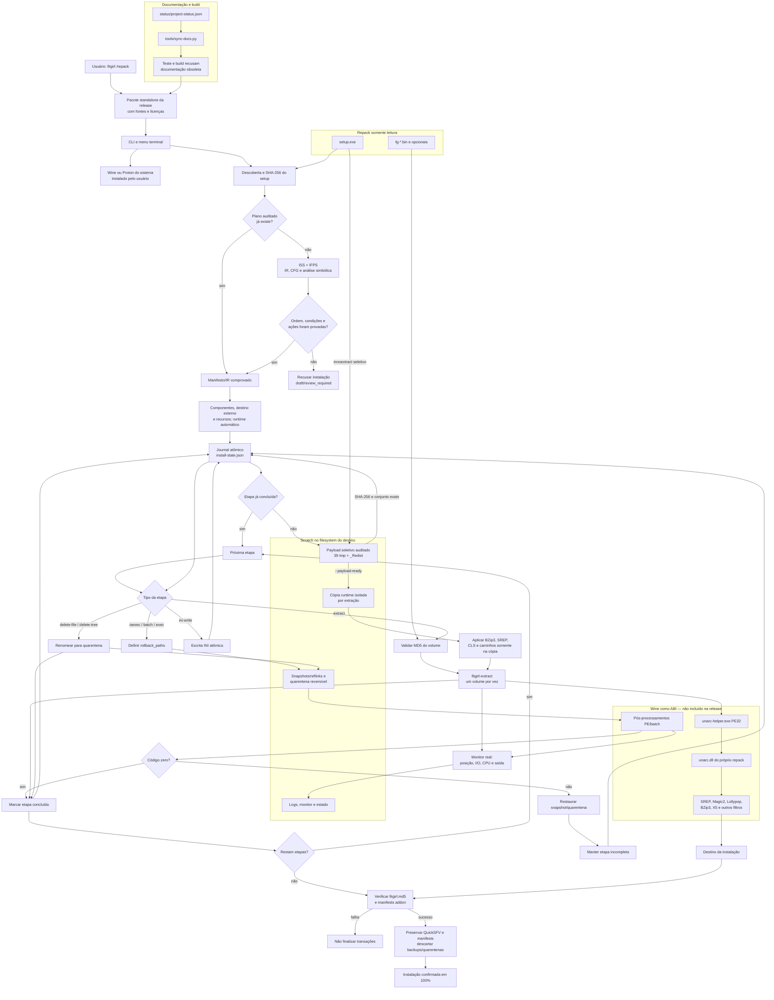

# Arquitetura atual

O projeto possui um único comando público, `fitgirl`. O controle permanece no
Linux; Wine é usado somente como ABI para DLLs, codecs e pós-processamentos PE.
O `setup.exe` é lido como contêiner e fonte de metadados, mas nunca é executado.

Arquivos para visualização externa com pan/zoom:

- [`architecture.pdf`](architecture.pdf) — diagrama vetorial pronto;
- [`architecture.dot`](architecture.dot) — fonte Graphviz versionável.

## Plataforma e pré-requisitos

O runtime atual é Linux x86-64 com glibc 2.38 ou superior e Python 3.12 ou
superior. O limite da glibc vem do maior símbolo exigido pelos binários ELF
fixados (`unarc` e ferramentas do runtime); versões inferiores são recusadas
antes de iniciar prompts ou instalação. Wine precisa estar instalado pelo
usuário para carregar DLLs e codecs Windows do repack.

O código Python usa somente a biblioteca padrão. O host fornece glibc, loader
ELF, `libstdc++`, `libgcc_s` e `liblzma`. O artefato inclui as bibliotecas Boost,
bzip2, zlib e zstd exigidas pelo `innoextract`, com avisos e inventário de hashes
no ZIP. Wine não é empacotado; `fitgirl doctor` procura Wine ou
Proton no PATH, nos locais usuais do Steam e em `FITGIRL_WINE_BIN`. Os demais comandos de sistema exigidos pela interface e
pelo backend também são verificados centralmente. `findmnt` só alimenta a lista
automática de discos; `taskset` e `nice` só são necessários ao solicitar essas
opções avançadas.

Em Debian/Ubuntu, os nomes dos pacotes correspondentes são `libc6` (na versão
mínima), `libstdc++6`, `libgcc-s1`, `python3` (3.12+), `bash`, `coreutils`, `tar`,
`gzip`, `gawk` ou `mawk`, `grep`, `sed`, `util-linux` e Wine (ou Proton
compatível). O artefato traz Boost e bibliotecas de compressão que o
`innoextract` usa; Wine e codecs continuam dependências do sistema ou do repack.

Debian 13, Ubuntu 24.04 LTS e CachyOS rolling x86-64 foram exercitados. Isso não
declara compatibilidade com toda distribuição que satisfaz a versão mínima: a
checagem `fitgirl doctor` informa host, bibliotecas, comandos e limites, e a
matriz empírica continua restrita a esses três ambientes. Ela não detecta todas
as bibliotecas Wine carregadas dinamicamente nem prova todos os codecs.

## Invariantes

- volumes seguem a ordem compilada do instalador, nunca ordem lexical;
- payload auditado é imutável durante a extração; ajustes ocorrem na cópia runtime;
- uma etapa só entra em `completed` após retorno bem-sucedido;
- falha ou sinal deixa a menor etapa segura retomável;
- remoções permanecem em quarentena até a verificação final;
- processos vivos sem avanço de posição, I/O ou saída não contam como progresso;
- caminhos de rollback ficam confinados ao destino e ao scratch;
- documentação operacional é gerada da fonte canônica e verificada por teste/build.

## Backends

1. **FreeArc nativo:** serve para formatos abertos, mas não lê descritores FA
   Protect (`descriptor failed CRC check`).
2. **FreeArcExtract customizado:** o helper PE32 carrega o `unarc.dll` extraído
   do repack e deixa que ele invoque somente os codecs exigidos pelo volume.
